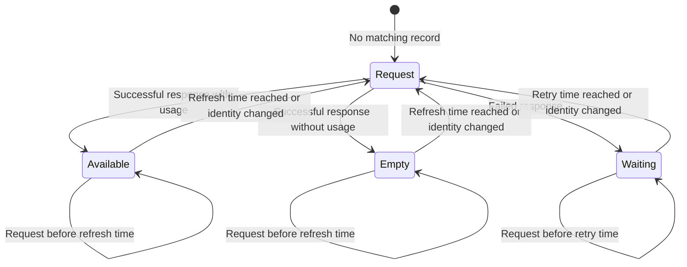
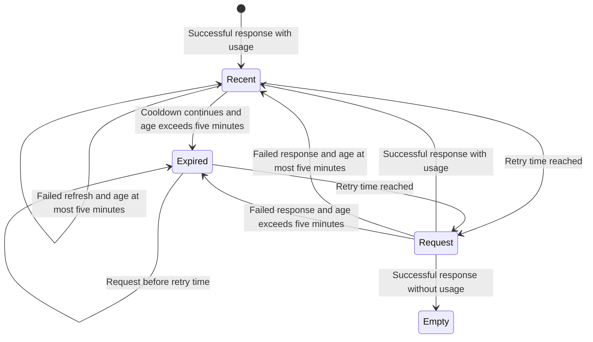

# Usage cache

The Claude statusline and OpenCode usage plugin share the provider collectors
in this directory.
The default cache lifetime is five seconds.
OpenCode also allows an automatic refresh attempt after five seconds on
session idle.

Provider snapshots use `~/.claude/cache/usage/<provider>.json` by default.
The path follows the user's home directory, regardless of the working
directory.
Direct `fetchUsage` callers can set `home` to change that root or `cacheDir`
to select an exact directory.
They can also set `cacheTtlMs` to override the lifetime or `cache: false` to
bypass persistence.

Provider `Retry-After` cooldowns can delay the next request beyond five
seconds.
Failed requests can retain a snapshot for up to five minutes under the
existing stale-data policy.
The OpenCode refresh command bypasses its idle refresh gate while preserving
the collector's cache and cooldown behavior.

Changing the default does not move or delete files from
`~/.claude/statusline/.cache/`.
An explicit `cacheDir` can still select that directory.
Existing records retain their saved retry times until the next request.
Installed copies need a separately owned source update and reload to activate
these defaults.

## Usage cache states

The cache associates each provider snapshot with a credential identity.
A changed identity ignores the previous record and starts a new request.

A failed request can retain a prior snapshot for the same identity.
The next diagram tracks a snapshot during a failed refresh.
The cooldown exceeds the cache lifetime.
Age is measured from the last successful response, not the latest failure.

A custom lifetime can keep a successful snapshot for over five minutes.
A successful empty response removes the previous snapshot.
The generated tests in `usage-cache.test.mjs` exercise sequential requests for
two identities and stale data during rate-limit cooldowns.
The tests use bounded inputs and do not prove behavior for concurrent requests
or provider-specific credential selection.
Run them with `pnpm run check:test`.

## Claude display

The first row starts with the model, effort, project, and Git branch.
Session cost, elapsed time, context usage, and token counts follow.
Zero cost, duration, and token counts are omitted.
The context bar has eight cells.
Positive usage fills at least one cell.
The host keeps session information on one row.
Claude Code may truncate its right edge in a narrow terminal.

Provider usage follows below, with at most two providers per row.
The primary provider appears first unless native Claude usage is available.
Native Claude usage replaces the Claude collector to avoid duplicates.
Paired provider rows align their column separators.
The longest left entry in the current output sets their position.
Reset-time changes can move both separators together.
Pairs must fit within 120 visible characters, including alignment padding.
Longer pairs move to separate rows.
A single oversized provider entry stays intact for the terminal to truncate.

Percentage metrics show the remaining allowance as `% left`.
Colors and `showAbove` filters still use the consumed percentage.
Usage counts and credit balances keep their original meaning.
They use compact display values, such as `211.3/1.5k` or `57.5k`.
Values below one thousand round to one decimal place.
Trailing zeroes are removed.
Reset times use compact forms such as `23h59m` or `5d14h`.
Trailing `Pro` and `Individual` plan suffixes are omitted from provider names.

These display changes do not change collector data or credentials.
Cache behavior is unchanged.
Use the repository's installation procedure to copy the updated `statusline.mjs`.

## Subagent rows

On Claude Code versions supporting `subagentStatusLine`, the setting runs
`subagent-statusline.mjs` with task JSON on stdin.
The command returns one JSON row per task.
Claude Code 2.1.323 marks this setting deprecated and ignores the command.
Updating this script does not customize the built-in rows in that version.

The left side shows status, agent name, model, effort, and description.
Long text is clipped on grapheme boundaries to reserve the right side for the
alternate worktree directory, token count, and elapsed time.
The rightmost field ends at the reported terminal width.
Hangul, emoji, and combining characters use terminal cell widths rather than
JavaScript string length.
In very narrow windows the directory is shortened first, then omitted.
If even tokens and elapsed time cannot fit, only elapsed time remains.
Without a valid width, the script emits an unpadded row.

The token field displays Claude Code's supplied `task.tokenCount` as `tok`.
It is not divided by the context window and is not labelled as context usage.
In the inspected 2.1.323 implementation, the progress count combines the latest
input tokens (including cache tokens), cumulative output, and a streaming estimate.
It is neither the current context size nor a sum of every request's token usage.
The old independent transcript sum is no longer displayed.
`in` is shown separately when the matching task transcript supplies a valid
latest assistant usage record. It sums `input_tokens`,
`cache_creation_input_tokens`, and `cache_read_input_tokens` from that record,
not across messages. Duplicate records are not added together. Missing or
invalid latest usage is hidden rather than replaced with an older value.
This is the last request's input, not live context after later output or tool
results. No percentage is inferred from the progress token count.
