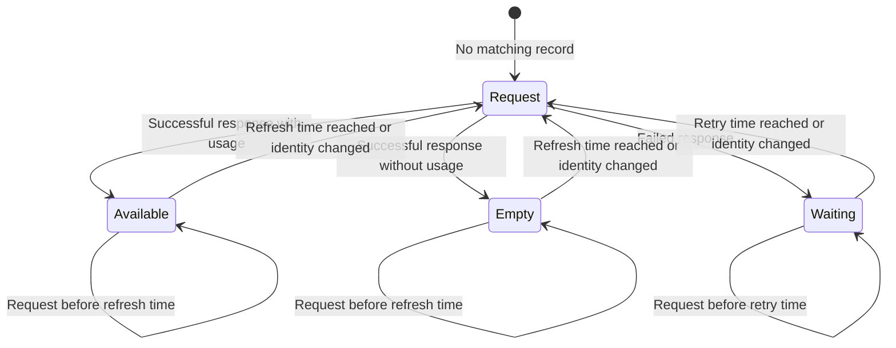
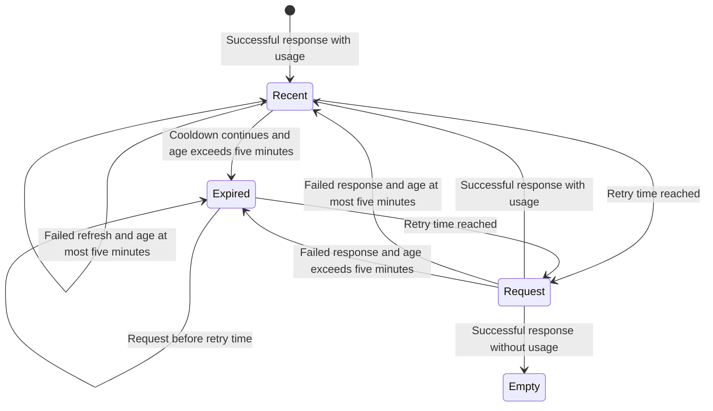

# Usage cache

The Claude statusline and OpenCode usage plugin share the provider collectors
in this directory.
The default cache lifetime is five seconds.
OpenCode also allows an automatic refresh attempt after five seconds on
session idle.

Provider snapshots use `~/.claude/cache/usage/<provider>.json` by default.
The path follows the user's home directory, regardless of the working
directory.
Direct `fetchUsage` callers can set `home` to change that root or `cacheDir`
to select an exact directory.
They can also set `cacheTtlMs` to override the lifetime or `cache: false` to
bypass persistence.

Provider `Retry-After` cooldowns can delay the next request beyond five
seconds.
Failed requests can retain a snapshot for up to five minutes under the
existing stale-data policy.
The OpenCode refresh command bypasses its idle refresh gate while preserving
the collector's cache and cooldown behavior.

Changing the default does not move or delete files from
`~/.claude/statusline/.cache/`.
An explicit `cacheDir` can still select that directory.
Existing records retain their saved retry times until the next request.
Installed copies need a separately owned source update and reload to activate
these defaults.

## Usage cache states

The cache associates each provider snapshot with a credential identity.
A changed identity ignores the previous record and starts a new request.

A failed request can retain a prior snapshot for the same identity.
The next diagram tracks a snapshot during a failed refresh.
The cooldown exceeds the cache lifetime.
Age is measured from the last successful response, not the latest failure.

A custom lifetime can keep a successful snapshot for over five minutes.
A successful empty response removes the previous snapshot.
The generated tests in `usage-cache.test.mjs` exercise sequential requests for
two identities and stale data during rate-limit cooldowns.
The tests use bounded inputs and do not prove behavior for concurrent requests
or provider-specific credential selection.
Run them with `pnpm test`.

## Claude display

The first row starts with the model, effort, project, and Git branch.
Session cost, elapsed time, context usage, and token counts follow.
Zero cost, duration, and token counts are omitted.
The context bar has eight cells.
Positive usage fills at least one cell.
The host keeps session information on one row.
Claude Code may truncate its right edge in a narrow terminal.

Provider usage follows below, with at most two providers per row.
The primary provider appears first unless native Claude usage is available.
Native Claude usage replaces the Claude collector to avoid duplicates.
Paired provider rows align their column separators.
The longest left entry in the current output sets their position.
Reset-time changes can move both separators together.
Pairs must fit within 120 visible characters, including alignment padding.
Longer pairs move to separate rows.
A single oversized provider entry stays intact for the terminal to truncate.

Percentage metrics show the remaining allowance as `% left`.
Colors and `showAbove` filters still use the consumed percentage.
Usage counts and credit balances keep their original meaning.
They use compact display values, such as `211.3/1.5k` or `57.5k`.
Values below one thousand round to one decimal place.
Trailing zeroes are removed.
Reset times use compact forms such as `23h59m` or `5d14h`.
Trailing `Pro` and `Individual` plan suffixes are omitted from provider names.

These display changes do not change collector data or credentials.
Cache behavior is unchanged.
Use the repository's installation procedure to copy the updated `statusline.mjs`.

## Subagent rows

The project's `subagentStatusLine` setting renders each subagent row in the
subagent panel through `subagent-statusline.mjs`.
Claude Code sends the visible rows as JSON on stdin and the script answers
with one JSON object per row.
Each row shows the agent name, model, effort, status, token count, and
progress summary in that order.
The name falls back to the agent type, and the summary falls back from the
label to the description.
The model and effort segments are omitted when a task does not carry them.
Rows are clipped to the width reported by Claude Code, counting wide
characters such as Hangul and emoji as two cells.
The agent name outranks the model, effort, status, token count, and summary
when the row runs out of space.
The token count is never truncated mid-value; it drops off whole when the row
runs out of space.
Running rows use green, failed and killed rows use the warning color, and all
other statuses stay dim.
Rows without a task id keep Claude Code's default rendering.
Malformed input produces no rows, which also keeps the default rendering.
